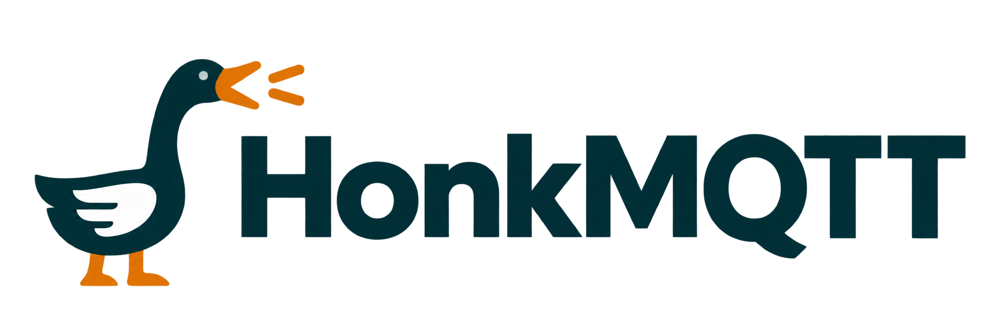

<h1></h1>

MQTT 3.1.1 packet codec and topic matching for Goose.

HonkMQTT reads and writes all 14 MQTT 3.1.1 packet types in caller-owned
buffers. Your application handles the transport and session state.

**Development preview** · [`v0.1.0-alpha.1`](https://github.com/x4g4p3x/honkmqtt/releases/tag/v0.1.0-alpha.1)

## Quickstart

Install [Goose v2026.4](https://github.com/aardappel/goose/releases/tag/v2026.4)
or newer. Save this as `main.goose` and run `goose run main.goose`.

```goose
import honkmqtt from "x4g4p3x/honkmqtt@v0.1.0-alpha.1";

fn main() {
    let status, consumed = honkmqtt::pingreq([0xc0, 0x00]);
    assert(status == honkmqtt::OK && consumed == 2);
}
```

## Documentation

- [Codec API](docs/api.md) · [PUBLISH example](docs/api.md#publish-example)
- [Transport integration](docs/transport.md)
- [Development and verification](docs/development.md)
- [Roadmap](ROADMAP.md) · [Versioning policy](VERSIONING.md)

[MIT license](LICENSE)
